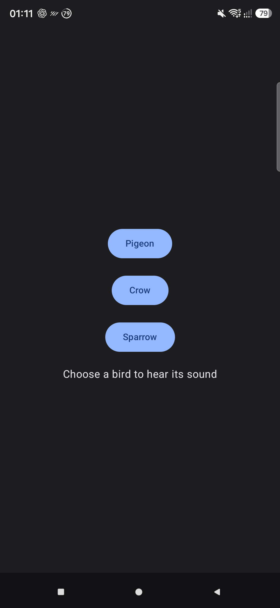
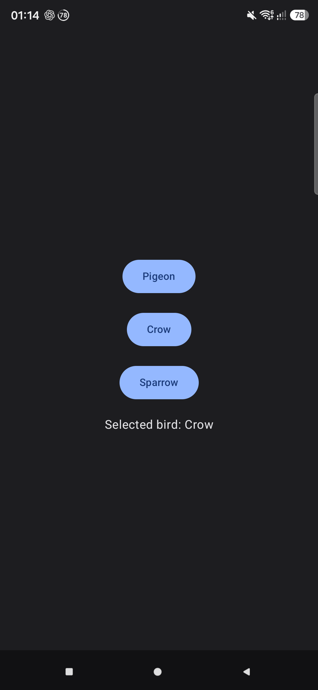
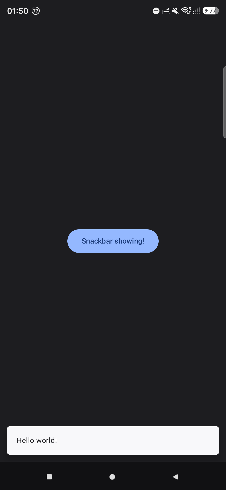
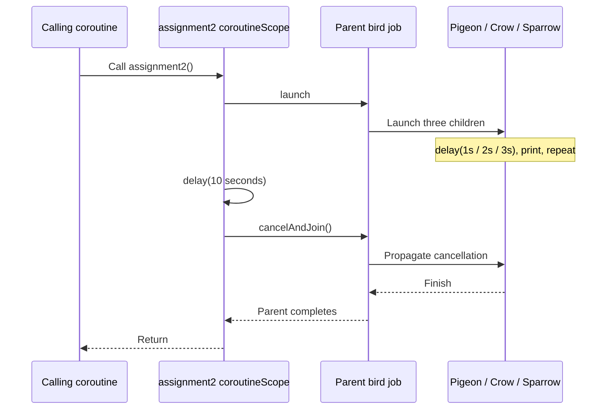
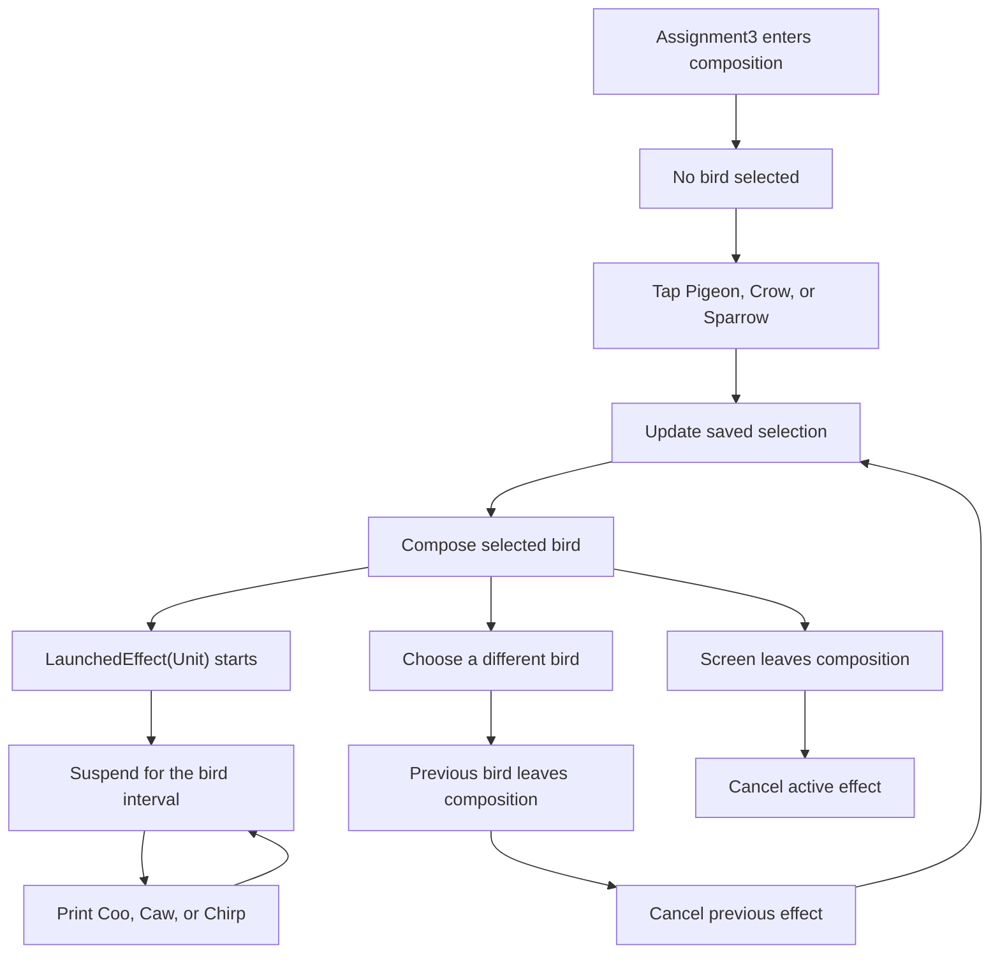

# Kotlin Coroutines Flow

A single-module Android learning project for Kotlin coroutines and Jetpack Compose, following PL Coding courses. Small lessons explore coroutine builders, suspension, jobs, cancellation, dispatchers, and coroutine lifetimes in Compose.

The current implementation focuses on **coroutine basics and coroutine contexts**. Although the repository name includes Flow, there are no Flow, StateFlow, or SharedFlow lessons implemented yet.

## What runs today

[MainActivity.kt](app/src/main/java/com/viniciuscoscia/kotlincoroutinesflow/MainActivity.kt) starts two demonstrations:

- `CoroutineBasicsHomework.Assignment3()` renders a bird selector.
- `CoroutineContextLessons.unconfinedDispatcher()` prints the threads used while switching coroutine contexts.

Choose **Pigeon**, **Crow**, or **Sparrow** to start the corresponding repeating coroutine. Its call is printed to Logcat after every interval; the screen displays the selected bird's name. The UI says “hear its sound,” but this exercise prints text and does not play audio.

The counter, snackbar, and rotating box are separate composables. There is no in-app navigation between lessons; change the composable in `MainActivity` to explore them.

## Screenshots

These screenshots were captured from the app running on a connected Android device. They show the lesson screens and their states. See [Switching lessons](#switching-lessons) to run each composable.

### Bird selector

<p>
  
  
</p>
<p>
  
  
</p>

### Compose coroutine examples

<p>
  
  
</p>
<p>
  
  
</p>

## Toolchain and requirements

The following versions are configured in the repository; they are not a recommendation to upgrade an unrelated project.

| Setting | Configured value |
| --- | --- |
| Gradle wrapper | 9.7.1 |
| Android Gradle Plugin | 9.5.0-rc01 |
| Kotlin Compose plugin | 2.4.20 |
| Compose BOM | 2026.09.00 |
| Gradle daemon JVM criteria | Java 25 |
| Java source / target compatibility | Java 11 |
| Android compile SDK / target SDK | 37 / 37 |
| Minimum Android SDK | 28 — Android 9 |
| Application ID and namespace | `com.viniciuscoscia.kotlincoroutinesflow` |
| App version | `1.0` (`versionCode = 1`) |
| Local test framework | JUnit 4.13.2 |

Use Android Studio with support for the configured AGP release candidate, Android SDK Platform 37, and a physical device or emulator running API 28 or newer. The Java 11 compile settings describe source/bytecode compatibility; the Gradle daemon criteria request Java 25.

[gradle/libs.versions.toml](gradle/libs.versions.toml) centralizes dependency versions. Other configured libraries include Activity 1.13.0, Lifecycle Runtime 2.11.0, Core KTX 1.19.0, and Coil 3.6.3. Coil is available as a dependency but these screens do not implement image loading or a network profile backend.

## Getting started

### Android Studio

1. Clone the repository and open its root folder in Android Studio.
2. Let Gradle sync finish. Install SDK Platform 37 if prompted, and make the requested Java 25 daemon toolchain available.
3. Select the `app` run configuration and an API 28+ device or emulator.
4. Run the application. The initial screen is the bird selector.
5. Open Logcat, select this application's process, and search for `Coo`, `Caw`, `Chirp`, or `Thread:` to inspect coroutine output.

The wrapper distribution, Maven dependencies, SDK packages, and any automatically resolved JVM toolchain require network access on first setup. Android Studio normally creates the machine-specific SDK configuration in `local.properties`; keep local paths out of commits.

### Command line

Clone with SSH, using a GitHub SSH key configured on your machine:

```bash
git clone git@github.com:viniciuscoscia/Kotlin-Coroutines-Flow.git
cd Kotlin-Coroutines-Flow
```

Run commands from the repository root. On Windows PowerShell:

```powershell
.\gradlew.bat assembleDebug
.\gradlew.bat test
.\gradlew.bat lint
.\gradlew.bat connectedDebugAndroidTest
```

On macOS or Linux:

```bash
./gradlew assembleDebug
./gradlew test
./gradlew lint
./gradlew connectedDebugAndroidTest
```

If the Unix wrapper lacks execute permission, run `chmod +x gradlew` once. The debug APK is generated at `app/build/outputs/apk/debug/app-debug.apk`. Build and local unit tests do not require a connected device; instrumentation tests require a running emulator or connected device.

## Learning path

### 1. Coroutine builders, jobs, and deferred results

[CoroutineBasicsLessons.kt](app/src/main/java/com/viniciuscoscia/kotlincoroutinesflow/_1coroutinebasics/CoroutineBasicsLessons.kt) contains these small demonstrations:

| Entry point | What to observe |
| --- | --- |
| `example1()` | Two `GlobalScope.launch` blocks: one suspends between messages and one prints without delay. |
| `example2()` | Nested jobs print after different delays; a parent waits for its children before completing. |
| `example3()` | A rotating box alongside a global Main-dispatcher coroutine that suspends and then blocks the UI thread. |
| `ComponentActivity.jobsAndDeferred()` | `join()` waits for jobs; `async` and `await()` retrieve simulated profile and posts results. |

In `jobsAndDeferred()`, the first two children delay for two seconds and one second concurrently, so waiting for both takes roughly two seconds. The simulated profile and posts requests delay for two and three seconds concurrently, so awaiting both takes roughly three seconds. The returned strings are local placeholders.

### 2. Bird homework: timing and cancellation

[CoroutineBasicsHomework.kt](app/src/main/java/com/viniciuscoscia/kotlincoroutinesflow/_1coroutinebasics/CoroutineBasicsHomework.kt) presents the same birds under three lifetime models.

| Bird | Message | Interval |
| --- | --- | --- |
| Pigeon | `Coo` | 1 second |
| Crow | `Caw` | 2 seconds |
| Sparrow | `Chirp` | 3 seconds |

**Assignment 1 — `assignment1()`.** Three global jobs each print four times. The first message occurs after the first interval, so the pigeon finishes around four seconds, the crow around eight, and the sparrow around twelve. `joinAll()` waits for all three. A `finally` block explicitly cancels the global jobs if the caller stops waiting.

**Assignment 2 — `assignment2()`.** A suspending `coroutineScope` owns a parent job with three repeating child jobs. After ten seconds, it calls `cancelAndJoin()` on that parent. Cancelling the caller also cancels its children. Treat output near the ten-second boundary as scheduling-dependent.



**Assignment 3 — `Assignment3()`.** `rememberSaveable` holds the selection. Only the selected bird's composable enters the composition, and its `LaunchedEffect(Unit)` runs the repeating loop. Switching to a different bird removes the previous composable, cancels its effect, and starts a new interval for the new bird. Clicking the already selected bird does not restart the effect.



### 3. Coroutine lifetimes in Compose

- [CounterScreen.kt](app/src/main/java/com/viniciuscoscia/kotlincoroutinesflow/_1coroutinebasics/CounterScreen.kt) uses `produceState(initialValue = 0)` to increment a count after each one-second delay. Its producer is cancelled when it leaves the composition. The button itself has an empty click handler.
- [ProfileScreen.kt](app/src/main/java/com/viniciuscoscia/kotlincoroutinesflow/_1coroutinebasics/ProfileScreen.kt) launches `showSnackbar("Hello world!")` from `rememberCoroutineScope()` in a click handler. The label reads `currentSnackbarData`, so it follows the host's visible snackbar state, including queued messages.
- [RotatingBox.kt](app/src/main/java/com/viniciuscoscia/kotlincoroutinesflow/commons/RotatingBox.kt) uses `rememberInfiniteTransition` for a repeating one-second rotation of a red 100 dp square. It is a visual aid for observing UI responsiveness.

### 4. Coroutine contexts and dispatchers

[CoroutineContextLessons.kt](app/src/main/java/com/viniciuscoscia/kotlincoroutinesflow/_2coroutinecontext/CoroutineContextLessons.kt) contains:

- `queryDatabase()`: inspects `Job`, `CoroutineName`, `CoroutineExceptionHandler`, and `CoroutineDispatcher` in the current context, then launches a named Main-dispatcher scope. Despite its name, it does not query a database.
- `unconfinedDispatcher()`: enters Main, then Unconfined, then IO with nested `withContext` calls and prints thread names. The initial unconfined execution uses its caller's thread; subsequent execution depends on suspension/resumption. Do not depend on a specific worker thread number.
- [CoroutineContextsHomework.kt](app/src/main/java/com/viniciuscoscia/kotlincoroutinesflow/_2coroutinecontext/CoroutineContextsHomework.kt) is the separate context-homework workspace; the lessons and default screen described here use the basics implementation.

## Switching lessons

Inside `MainActivity.onCreate`, replace the current UI call within the theme:

```kotlin
setContent {
    KotlinCoroutinesFlowTheme {
        CounterScreen() // Or ProfileScreen()
    }
}
```

Add the matching import from `com.viniciuscoscia.kotlincoroutinesflow._1coroutinebasics`. To display the animation alone, use `RotatingBox(modifier = Modifier.fillMaxSize())` with imports for `commons.RotatingBox`, `Modifier`, and `fillMaxSize`. To observe the blocking demonstration, use `CoroutineBasicsLessons.example3()` instead.

Run a suspending assignment from a coroutine. For example, replace the existing `lifecycleScope.launch` block with:

```kotlin
lifecycleScope.launch {
    CoroutineBasicsHomework.assignment2()
}
```

Use `assignment1()` there to compare the global-job version. Run one experiment at a time for readable output. Avoid calling suspending functions directly from `onCreate`, blocking the UI with `runBlocking`, or launching work directly in a composable body on every recomposition.

## Deliberate pitfalls to study

These lessons include APIs and patterns intended for comparison:

- `GlobalScope` appears in `example1()`, `example2()`, `example3()`, `assignment1()`, and `unconfinedDispatcher()`. These jobs do not become children of a caller merely because the function was invoked inside `lifecycleScope.launch`. Prefer an owner with a clear lifetime in application code.
- `example3()` waits with `delay(3.seconds)`, then calls `Thread.sleep(3000L)` on `Dispatchers.Main`. The delay suspends; the sleep blocks the main thread and can freeze the animation. The inline comment suggesting otherwise should not be taken as the expected behavior.
- `queryDatabase()` creates a separate `CoroutineScope(Dispatchers.Main + CoroutineName(...))` without retaining or cancelling it. It demonstrates context contents rather than a complete owner-managed scope.
- `Dispatchers.Unconfined` in `unconfinedDispatcher()` illustrates execution behavior; it does not guarantee a fixed thread for UI work.

## Project structure

```text
KotlinCoroutinesFlow/
├── app/
│   ├── build.gradle.kts
│   └── src/
│       ├── main/
│       │   ├── java/com/viniciuscoscia/kotlincoroutinesflow/
│       │   │   ├── MainActivity.kt
│       │   │   ├── _1coroutinebasics/    # Lessons, bird homework, counter, snackbar
│       │   │   ├── _2coroutinecontext/   # Context lessons and homework
│       │   │   ├── commons/             # RotatingBox
│       │   │   └── ui/theme/            # Compose theme
│       │   └── res/                     # Android resources
│       ├── test/                        # Local JUnit tests
│       └── androidTest/                 # Device and Compose tests
├── docs/screenshots/                    # README screen captures
├── gradle/
│   ├── libs.versions.toml
│   ├── gradle-daemon-jvm.properties
│   └── wrapper/
├── .skills/grilling/                    # Repository-local Grill Me skill
├── AGENTS.md                            # Repository development guidelines
├── LICENSE                              # Apache License 2.0
└── settings.gradle.kts
```

## Validation and current coverage

Run `test` before handing off a change. Run `connectedDebugAndroidTest` for Compose interactions or Android framework behavior; use `assembleDebug` and `lint` to check build and static analysis.

| Test | Existing coverage |
| --- | --- |
| `ExampleUnitTest.addition_isCorrect` | Local JUnit smoke test asserting `2 + 2 == 4`. |
| `ExampleInstrumentedTest.useAppContext` | Confirms the installed application's package name. |
| `ProfileScreenTest.queuedSnackbars_keepShowingLabelUntilLastDismissed` | Queues two snackbars, dismisses each through semantics, and verifies the label stays active until the final dismissal. |

There are no dedicated automated tests for bird timing/cancellation, dispatcher output, the counter, or rotating-box animation. The screenshots illustrate UI states; they do not verify coroutine timing.

## Repository-local Grill Me skill

The project includes [`.skills/grilling/SKILL.md`](.skills/grilling/SKILL.md), a reusable interview workflow for stress-testing a plan or decision. In an agent that supports `@` skill invocation, use, for example:

```text
@grilling Help me choose the ownership and cancellation model for the next coroutine exercise.
```

It asks one question at a time, investigates discoverable facts, and builds a shared understanding before implementation. Invoking it alone does not authorize code changes. See [AGENTS.md](AGENTS.md) for this repository's coding, testing, and contribution conventions.

## License

This repository is licensed under the Apache License, Version 2.0. See [LICENSE](LICENSE) for the full terms.
