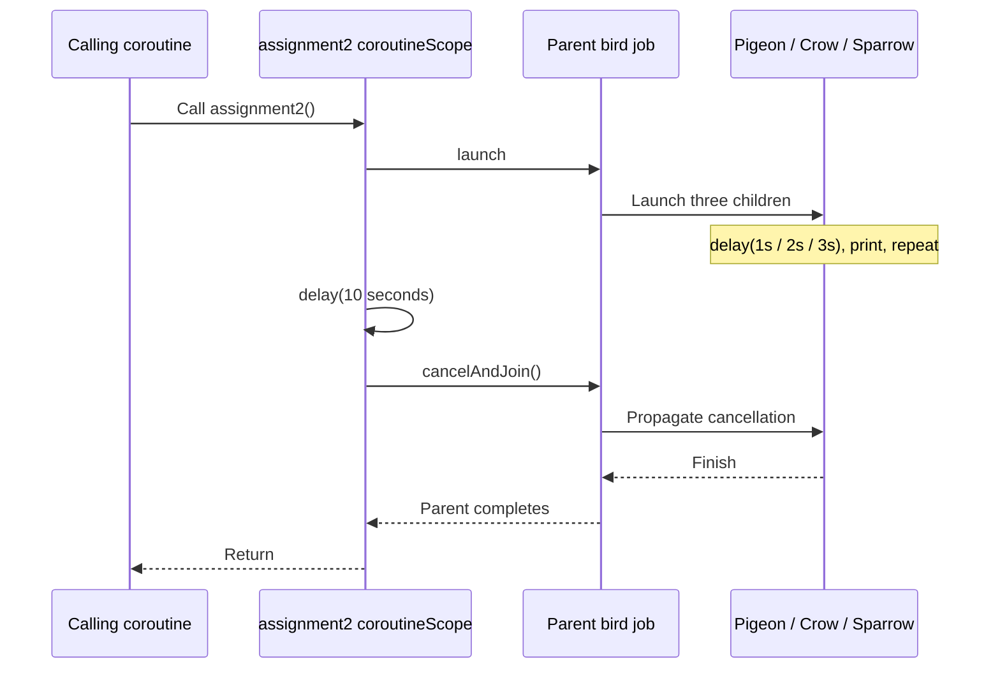
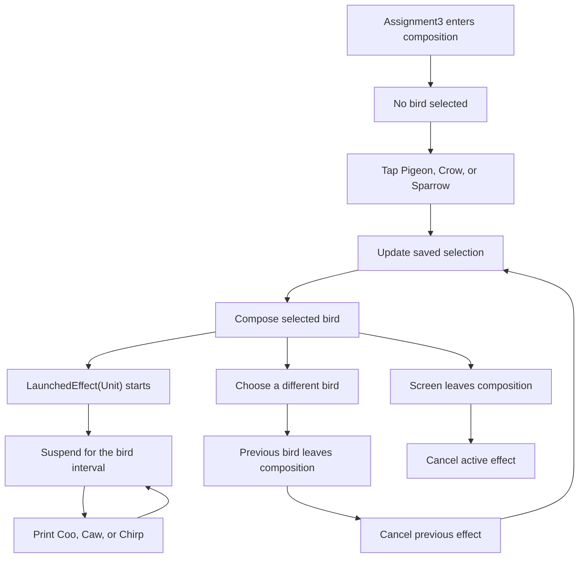

# Kotlin Coroutines Flow

A single-module Android learning project for Kotlin coroutines and Jetpack Compose, following PL Coding courses. Small lessons explore coroutine builders, suspension, jobs, cancellation, dispatchers, and coroutine lifetimes in Compose.

The current implementation focuses on **coroutine basics and coroutine contexts**. Although the repository name includes Flow, there are no Flow, StateFlow, or SharedFlow lessons implemented yet.

## What runs today

[MainActivity.kt](app/src/main/java/com/viniciuscoscia/kotlincoroutinesflow/MainActivity.kt) starts two demonstrations:

- `LessonSelector()` opens a Material3 list for the bird simulator, counter, profile snackbar, and rotating box.
- `CoroutineContextLessons.unconfinedDispatcher()` prints the threads used while switching coroutine contexts.

Choose **Pigeon**, **Crow**, or **Sparrow** to start the corresponding repeating coroutine. Its call is printed to Logcat after every interval; the screen displays the selected bird's name. The UI says “hear its sound,” but this exercise prints text and does not play audio.

Choose a lesson from the initial list. Use the toolbar **Back** button or Android system Back to return to the list. The selected lesson survives Activity recreation. Leaving a lesson removes it from the composition and cancels its Compose coroutines; opening it again starts a fresh lesson. The dispatcher demonstration continues to run from `MainActivity.onCreate`.

## Screenshots

These screenshots were captured from the app running on a connected Android device. They show the lesson screens and their states. See [Switching lessons](#switching-lessons) to run each composable.

### Bird selector

<p>
  
  
</p>
<p>
  
  
</p>

### Compose coroutine examples

<p>
  
  
</p>
<p>
  
  
</p>

## Toolchain and requirements

The following versions are configured in the repository; they are not a recommendation to upgrade an unrelated project.

| Setting | Configured value |
| --- | --- |
| Gradle wrapper | 9.7.1 |
| Android Gradle Plugin | 9.5.0-rc01 |
| Kotlin Compose plugin | 2.4.20 |
| Compose BOM | 2026.09.00 |
| Gradle daemon JVM criteria | Java 25 |
| Java source / target compatibility | Java 11 |
| Android compile SDK / target SDK | 37 / 37 |
| Minimum Android SDK | 28 — Android 9 |
| Application ID and namespace | `com.viniciuscoscia.kotlincoroutinesflow` |
| App version | `1.0` (`versionCode = 1`) |
| Local test framework | JUnit 4.13.2 |

Use Android Studio with support for the configured AGP release candidate, Android SDK Platform 37, and a physical device or emulator running API 28 or newer. The Java 11 compile settings describe source/bytecode compatibility; the Gradle daemon criteria request Java 25.

[gradle/libs.versions.toml](gradle/libs.versions.toml) centralizes dependency versions. Other configured libraries include Activity 1.13.0, Lifecycle Runtime 2.11.0, Core KTX 1.19.0, and Coil 3.6.3. Coil is available as a dependency but these screens do not implement image loading or a network profile backend.

## Getting started

### Android Studio

1. Clone the repository and open its root folder in Android Studio.
2. Let Gradle sync finish. Install SDK Platform 37 if prompted, and make the requested Java 25 daemon toolchain available.
3. Select the `app` run configuration and an API 28+ device or emulator.
4. Run the application. The initial screen lists the four available lessons.
5. Open Logcat, select this application's process, and search for `Coo`, `Caw`, `Chirp`, or `Thread:` to inspect coroutine output.

The wrapper distribution, Maven dependencies, SDK packages, and any automatically resolved JVM toolchain require network access on first setup. Android Studio normally creates the machine-specific SDK configuration in `local.properties`; keep local paths out of commits.

### Command line

Clone with SSH, using a GitHub SSH key configured on your machine:

```bash
git clone git@github.com:viniciuscoscia/Kotlin-Coroutines-Flow.git
cd Kotlin-Coroutines-Flow
```

Run commands from the repository root. On Windows PowerShell:

```powershell
.\gradlew.bat assembleDebug
.\gradlew.bat test
.\gradlew.bat lint
.\gradlew.bat connectedDebugAndroidTest
```

On macOS or Linux:

```bash
./gradlew assembleDebug
./gradlew test
./gradlew lint
./gradlew connectedDebugAndroidTest
```

If the Unix wrapper lacks execute permission, run `chmod +x gradlew` once. The debug APK is generated at `app/build/outputs/apk/debug/app-debug.apk`. Build and local unit tests do not require a connected device; instrumentation tests require a running emulator or connected device.

## Learning path

### 1. Coroutine builders, jobs, and deferred results

[CoroutineBasicsLessons.kt](app/src/main/java/com/viniciuscoscia/kotlincoroutinesflow/_1coroutinebasics/CoroutineBasicsLessons.kt) contains these small demonstrations:

| Entry point | What to observe |
| --- | --- |
| `example1()` | Two `GlobalScope.launch` blocks: one suspends between messages and one prints without delay. |
| `example2()` | Nested jobs print after different delays; a parent waits for its children before completing. |
| `example3()` | A rotating box alongside a global Main-dispatcher coroutine that suspends and then blocks the UI thread. |
| `ComponentActivity.jobsAndDeferred()` | `join()` waits for jobs; `async` and `await()` retrieve simulated profile and posts results. |

In `jobsAndDeferred()`, the first two children delay for two seconds and one second concurrently, so waiting for both takes roughly two seconds. The simulated profile and posts requests delay for two and three seconds concurrently, so awaiting both takes roughly three seconds. The returned strings are local placeholders.

### 2. Bird homework: timing and cancellation

[CoroutineBasicsHomework.kt](app/src/main/java/com/viniciuscoscia/kotlincoroutinesflow/_1coroutinebasics/CoroutineBasicsHomework.kt) presents the same birds under three lifetime models.

| Bird | Message | Interval |
| --- | --- | --- |
| Pigeon | `Coo` | 1 second |
| Crow | `Caw` | 2 seconds |
| Sparrow | `Chirp` | 3 seconds |

**Assignment 1 — `assignment1()`.** Three global jobs each print four times. The first message occurs after the first interval, so the pigeon finishes around four seconds, the crow around eight, and the sparrow around twelve. `joinAll()` waits for all three. A `finally` block explicitly cancels the global jobs if the caller stops waiting.

**Assignment 2 — `assignment2()`.** A suspending `coroutineScope` owns a parent job with three repeating child jobs. After ten seconds, it calls `cancelAndJoin()` on that parent. Cancelling the caller also cancels its children. Treat output near the ten-second boundary as scheduling-dependent.



**Assignment 3 — `Assignment3()`.** `rememberSaveable` holds the selection. Only the selected bird's composable enters the composition, and its `LaunchedEffect(Unit)` runs the repeating loop. Switching to a different bird removes the previous composable, cancels its effect, and starts a new interval for the new bird. Clicking the already selected bird does not restart the effect.



### 3. Coroutine lifetimes in Compose

- [CounterScreen.kt](app/src/main/java/com/viniciuscoscia/kotlincoroutinesflow/_1coroutinebasics/CounterScreen.kt) uses `produceState(initialValue = 0)` to increment a count after each one-second delay. Its producer is cancelled when it leaves the composition. The button itself has an empty click handler.
- [ProfileScreen.kt](app/src/main/java/com/viniciuscoscia/kotlincoroutinesflow/_1coroutinebasics/ProfileScreen.kt) launches `showSnackbar("Hello world!")` from `rememberCoroutineScope()` in a click handler. The label reads `currentSnackbarData`, so it follows the host's visible snackbar state, including queued messages.
- [RotatingBox.kt](app/src/main/java/com/viniciuscoscia/kotlincoroutinesflow/commons/RotatingBox.kt) uses `rememberInfiniteTransition` for a repeating one-second rotation of a red 100 dp square. It is a visual aid for observing UI responsiveness.

### 4. Coroutine contexts and dispatchers

[CoroutineContextLessons.kt](app/src/main/java/com/viniciuscoscia/kotlincoroutinesflow/_2coroutinecontext/CoroutineContextLessons.kt) contains:

- `queryDatabase()`: inspects `Job`, `CoroutineName`, `CoroutineExceptionHandler`, and `CoroutineDispatcher` in the current context, then launches a named Main-dispatcher scope. Despite its name, it does not query a database.
- `unconfinedDispatcher()`: enters Main, then Unconfined, then IO with nested `withContext` calls and prints thread names. The initial unconfined execution uses its caller's thread; subsequent execution depends on suspension/resumption. Do not depend on a specific worker thread number.
- [CoroutineContextsHomework.kt](app/src/main/java/com/viniciuscoscia/kotlincoroutinesflow/_2coroutinecontext/CoroutineContextsHomework.kt) is the separate context-homework workspace; the lessons and default screen described here use the basics implementation.

## Switching lessons

Select **Bird simulator**, **Counter**, **Profile snackbar**, or **Rotating box** in the app. The toolbar **Back** button and Android system Back return to the list. The blocking demonstration remains a separate experiment: replace `LessonSelector()` in `MainActivity` with `CoroutineBasicsLessons.example3()` to observe it.

Run a suspending assignment from a coroutine. For example, replace the existing `lifecycleScope.launch` block with:

```kotlin
lifecycleScope.launch {
    CoroutineBasicsHomework.assignment2()
}
```

Use `assignment1()` there to compare the global-job version. Run one experiment at a time for readable output. Avoid calling suspending functions directly from `onCreate`, blocking the UI with `runBlocking`, or launching work directly in a composable body on every recomposition.

## Deliberate pitfalls to study

These lessons include APIs and patterns intended for comparison:

- `GlobalScope` appears in `example1()`, `example2()`, `example3()`, `assignment1()`, and `unconfinedDispatcher()`. These jobs do not become children of a caller merely because the function was invoked inside `lifecycleScope.launch`. Prefer an owner with a clear lifetime in application code.
- `example3()` waits with `delay(3.seconds)`, then calls `Thread.sleep(3000L)` on `Dispatchers.Main`. The delay suspends; the sleep blocks the main thread and can freeze the animation. The inline comment suggesting otherwise should not be taken as the expected behavior.
- `queryDatabase()` creates a separate `CoroutineScope(Dispatchers.Main + CoroutineName(...))` without retaining or cancelling it. It demonstrates context contents rather than a complete owner-managed scope.
- `Dispatchers.Unconfined` in `unconfinedDispatcher()` illustrates execution behavior; it does not guarantee a fixed thread for UI work.

## Project structure

```text
KotlinCoroutinesFlow/
├── app/
│   ├── build.gradle.kts
│   └── src/
│       ├── main/
│       │   ├── java/com/viniciuscoscia/kotlincoroutinesflow/
│       │   │   ├── MainActivity.kt
│       │   │   ├── _1coroutinebasics/    # Lessons, bird homework, counter, snackbar
│       │   │   ├── _2coroutinecontext/   # Context lessons and homework
│       │   │   ├── commons/             # RotatingBox
│       │   │   └── ui/theme/            # Compose theme
│       │   └── res/                     # Android resources
│       ├── test/                        # Local JUnit tests
│       └── androidTest/                 # Device and Compose tests
├── docs/screenshots/                    # README screen captures
├── gradle/
│   ├── libs.versions.toml
│   ├── gradle-daemon-jvm.properties
│   └── wrapper/
├── .skills/grilling/                    # Repository-local Grill Me skill
├── AGENTS.md                            # Repository development guidelines
├── LICENSE                              # Apache License 2.0
└── settings.gradle.kts
```

## Validation and current coverage

Run `test` before handing off a change. Run `connectedDebugAndroidTest` for Compose interactions or Android framework behavior; use `assembleDebug` and `lint` to check build and static analysis.

| Test | Existing coverage |
| --- | --- |
| `ExampleUnitTest.addition_isCorrect` | Local JUnit smoke test asserting `2 + 2 == 4`. |
| `ExampleInstrumentedTest.useAppContext` | Confirms the installed application's package name. |
| `LessonSelectorTest` | Checks the initial list, all four lesson destinations, toolbar and system Back, Activity recreation, and fresh lesson state after leaving. |
| `ProfileScreenTest.queuedSnackbars_keepShowingLabelUntilLastDismissed` | Queues two snackbars, dismisses each through semantics, and verifies the label stays active until the final dismissal. |

There are no dedicated automated tests for precise bird timing/cancellation, dispatcher output, or rotating-box animation. The selector tests check counter progress and fresh state on reentry. The screenshots illustrate UI states; they do not verify coroutine timing.

## Repository-local Grill Me skill

The project includes [`.skills/grilling/SKILL.md`](.skills/grilling/SKILL.md), a reusable interview workflow for stress-testing a plan or decision. In an agent that supports `@` skill invocation, use, for example:

```text
@grilling Help me choose the ownership and cancellation model for the next coroutine exercise.
```

It asks one question at a time, investigates discoverable facts, and builds a shared understanding before implementation. Invoking it alone does not authorize code changes. See [AGENTS.md](AGENTS.md) for this repository's coding, testing, and contribution conventions.

## License

This repository is licensed under the Apache License, Version 2.0. See [LICENSE](LICENSE) for the full terms.


## Multiplatform laboratory — 2026-10-23

One Gradle build now contains `app:androidApp` (existing app/src preserved), `app:desktopApp`, `app:webApp`, `app:shared`, portable KMP `core`, and Kotlin Spring Boot `server`. Kotlin2.4.20, Android SDK37/min28/bytecode11, Gradle9.5.1/AGP9.1.1, Compose Multiplatform1.12.1, SpringBoot4.1.2/JDK25 have been built locally. Financial Doc was inspected read only; its Ktor server was not copied.

The original selector remains the initial Android destination. Open **Open multiplatform laboratory** for the shared UI. Import a real UTF-8 text file up to1MiB; only a dedicated copy is read (Android app files, Desktop .coroutine-laboratory/imports, browser Origin Private File System). Runs load at most2,000 lines; events retain last200 entries with bounded ingress. JVM/Android blocking I/O uses two-worker dispatcher views. Browser code labels its event-loop ownership rather than pretending it has JVM threads.

- Android: `./gradlew :app:androidApp:assembleDebug`
- Desktop: `./gradlew :app:desktopApp:run` or `:app:desktopApp:createDistributable`
- Web: `./gradlew :app:webApp:jsBrowserDevelopmentRun` (loopback dev port8081), or `:app:webApp:jsBrowserDistribution`
- Spring: explicit IDE **Backend Development** / **Backend Optimized**, or `./gradlew :server:bootRun --args=--spring.profiles.active=dev`. Binds127.0.0.1:8080 by default. No background/login service.
- Android tests: rediscover a physical serial, set ANDROID_SERIAL explicitly, keep the phone awake/unlocked, run `:app:androidApp:connectedDebugAndroidTest`.
- Portable checks: `:core:jvmTest :core:jsBrowserTest`; ChromeHeadless is used by the browser tests.

IDE run configurations control backend/tunnel only. Android and DSH launch separately. Private tunnel requires your SSH host configuration; no credentials are stored in this repository.

### What the 43 entries prove

The table tracks original teaching bodies, not course completion or homework solutions. All-demo automated checks use a small clearly identified file fixture. Android additionally copies an actual test asset into its dedicated sandbox. Production UI requires a real file import. Source shown for each selection is the executing body; JVM lock/container/confinement implementations are also shown. Course homework/hints/assessment files were left intact and not solved.

- **Network distinction:** demo37 automated checks use explicitly named network fixtures. Separate real backend acceptance verified actual multipart copy/read and an RFC6455 matching probe acknowledgment. This does not claim a user completed the WebSocket UI on every client.
- **Main distinction:** common JVM/browser tests replace Main with a test dispatcher; they cannot prove platform Main.immediate ordering. A dedicated Android instrumentation test checks inline-immediate → caller → dispatched-Main order on the actual UI dispatcher.
- **Confinement distinction:** demo26 includes a real owned Executor dispatcher on JVM/Android, closes it after use and checks affinity across suspension. Browser displays its single-event-loop equivalent. JVM synchronized and ConcurrentHashMap/synchronizedList branches are real JVM implementations.
- Compose lifecycle behavior is exercised by shared UI entry/return; deeper cancellation/sensor/Safety Access Framework interaction and manual Desktop/Web import acceptance remain separate from engine tests.

| ID | Module / original teaching topic | Special evidence boundary |
|---|---|---|
| 1 | Coroutine Basics / What Is a Coroutine? | Executing body + observable events; live UI acceptance separate |
| 2 | Coroutine Basics / Launching your first coroutines | Executing body + observable events; live UI acceptance separate |
| 3 | Coroutine Basics / Suspend Functions | Executing body + observable events; live UI acceptance separate |
| 4 | Coroutine Basics / Coroutine Scopes | Executing body + observable events; live UI acceptance separate |
| 5 | Coroutine Basics / Jobs & Deferreds | Executing body + observable events; live UI acceptance separate |
| 6 | Coroutine Basics / Coroutines in Compose | Composition-owned scope; UI interaction separate |
| 7 | Coroutine Contexts / What Is a Coroutine Context | Executing body + observable events; live UI acceptance separate |
| 8 | Coroutine Contexts / withContext | Executing body + observable events; live UI acceptance separate |
| 9 | Coroutine Contexts / IO & Default Dispatcher | Executing body + observable events; live UI acceptance separate |
| 10 | Coroutine Contexts / Main & Main Immediate Dispatcher | Actual Android ordering assertion; test Main elsewhere |
| 11 | Coroutine Contexts / Unconfined Dispatcher | Executing body + observable events; live UI acceptance separate |
| 12 | Coroutine Cancellation / Why Cancellation Seems Simple, But Is Hard | Executing body + observable events; live UI acceptance separate |
| 13 | Coroutine Cancellation / The Consequences of Cancellation | Executing body + observable events; live UI acceptance separate |
| 14 | Coroutine Cancellation / Cancellation Trap #1: try/catch | Executing body + observable events; live UI acceptance separate |
| 15 | Coroutine Cancellation / Cancellation Trap #2: Transaction-like Behavior | Executing body + observable events; live UI acceptance separate |
| 16 | Coroutine Cancellation / Cancellation Trap #3: try/finally | Executing body + observable events; live UI acceptance separate |
| 17 | Coroutine Cancellation / ensureActive() vs yield() | Executing body + observable events; live UI acceptance separate |
| 18 | Coroutine Error Handling / How Coroutines Treat Exceptions | Executing body + observable events; live UI acceptance separate |
| 19 | Coroutine Error Handling / Catching Errors With CoroutineExceptionHandler | Executing body + observable events; live UI acceptance separate |
| 20 | Coroutine Error Handling / SupervisorJob | Executing body + observable events; live UI acceptance separate |
| 21 | Coroutine Error Handling / coroutineScope & supervisorScope | Executing body + observable events; live UI acceptance separate |
| 22 | Combining What You've Learnt So Far / Converting a Callback to a Suspend Function | Imported-record callback adaptation; no fake device input |
| 23 | Coroutine Synchronization / When Do You Have to Think of Synchronization | Executing body + observable events; live UI acceptance separate |
| 24 | Coroutine Synchronization / synchronized and Mutex | Mutex + actual JVM synchronized; browser event-loop equivalent |
| 25 | Coroutine Synchronization / Concurrent Lists and HashMaps | Actual JVM concurrent containers; browser event-loop equivalent |
| 26 | Coroutine Synchronization / Single Thread Dispatcher | Actual JVM dedicated dispatcher; browser event-loop equivalent |
| 27 | Flow Fundamentals / What Is a Flow | Executing body + observable events; live UI acceptance separate |
| 28 | Flow Fundamentals / The Structure of Every Launched Flow | Executing body + observable events; live UI acceptance separate |
| 29 | Flow Fundamentals / SharedFlow | Executing body + observable events; live UI acceptance separate |
| 30 | Flow Fundamentals / StateFlow | Executing body + observable events; live UI acceptance separate |
| 31 | Flow Fundamentals / Making a cold Flow hot with stateIn() | Executing body + observable events; live UI acceptance separate |
| 32 | Flow Fundamentals / Making a cold Flow hot with shareIn() | Executing body + observable events; live UI acceptance separate |
| 33 | Flow Fundamentals / Callback Flow | Imported-record callbackFlow cleanup; sensor UI separate |
| 34 | Flows In Practice / Building a Timer Flow | Executing body + observable events; live UI acceptance separate |
| 35 | Flows In Practice / Transforming Tracked Locations With zip() and combine() | Executing body + observable events; live UI acceptance separate |
| 36 | Flows In Practice / Combining UI States | Executing body + observable events; live UI acceptance separate |
| 37 | Flows In Practice / Listening to a WebSocket Stream In a Flow | Network fixture in engine tests; actual backend transport separately verified |
| 38 | Flows In Practice / Handling Flow Errors & Retrying Failed Flows | Executing body + observable events; live UI acceptance separate |
| 39 | Flows In Practice / flatMapConcat / flatMapMerge / flatMapLatest | Executing body + observable events; live UI acceptance separate |
| 40 | Flows In Practice / Handling Backpressure | Executing body + observable events; live UI acceptance separate |
| 41 | Testing Coroutines & Flows / Testing Suspending Functions | Virtual-time suspending test + executing invariant |
| 42 | Testing Coroutines & Flows / Testing Code That Launches Coroutines | Joined launched work + virtual-time companion test |
| 43 | Testing Coroutines & Flows / Testing Flows | Exact flow values + virtual-time companion test |

### Backend API and measurements

- GET `/ready` → ready/profile; GET `/actuator/health/readiness` → readiness health.
- POST `/files`, multipart `file`, max1MiB → generated sandbox name/byte/line receipt.
- GET `/files` → up to100 accurate summaries. GET `/files/{generated-id}` → copied UTF-8 text; client paths are rejected.
- WS `/events` → real heartbeat JSON. A raw alphanumeric/hyphen probe up to80 characters receives `{event:"ack",probe:"same-token"}`. Sessions cap8 and per-session buffering/message cap8KiB.

Use the standard-library **Python** runner on Mac or Windows: `python3 tools/benchmark_backend.py your-variants.json`. It defaults to ten alternating fresh starts per supplied variant; measures readiness, real copy+read equality, matching WebSocket roundtrip and RSS via macOS `ps`/Windows process APIs. No PowerShell installation is required for measurement. Preparation times and exact build/Java metadata belong in config.preparation and remain separate from starts. See docs/BACKEND-BENCHMARKS.md. `smoke_only` plus `--samples 1` is explicitly non-acceptance smoke verification.

Optimized JVM/Spring-AOT preparation is implemented. Native plugin tasks configure but no target Native Image is claimed. No real Mac startup samples, private Mac tunnel or benchmark-selected winner are claimed. Exact current commands/results and unresolved interactive gaps are in LAB-IMPLEMENTATION.md.
